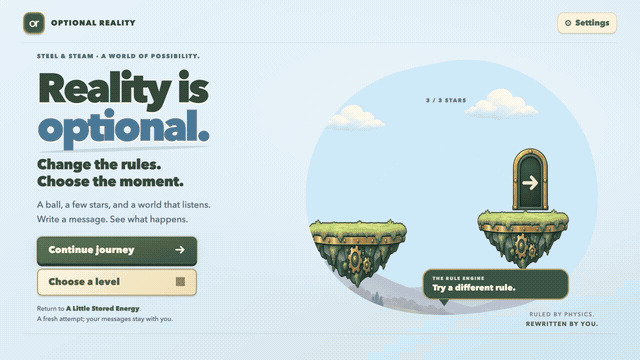

# Looping gameplay demo

**47 seconds · 1280 × 720 · 30 fps · music + gameplay cues · English narrated edition**

[Download / watch the sound loop](./gameplay-sound.mp4) · [English narrated MP4 with subtitles](./youtube-demo-subtitled.mp4) · [Looping player](./index.html) · [English captions](./captions.en.vtt) · [中文字幕](./captions.zh.vtt)



The footage includes chapter/level selection and visible automatic typing through the normal interface:

| Start | Level | Recorded action | Result |
| --- | --- | --- | --- |
| 00:04.6 | 01.3 Bring It Back | Queue `acceleration leftward 1`; Start, then send near the middle star | 3/3 stars |
| 00:20.8 | 02.5 Bank Shot | Type `Set surface bounce to 1`, then Send now | 3/3 stars |
| 00:32.3 | 03.1 A Little Stored Energy | Start; first contact pauses; type `Set toaster power to 2`; Send now; Continue | 3/3 stars |

The recording uses the actual browser UI, Matter.js simulation, collision geometry, and scoring. Only the typing and normal control clicks are automated. No body position, velocity, score, timing rule, or permission was modified. The explicit commands are recognized by the local parser, so this video does not demonstrate a live LLM request or claim model latency. See [AI usage and credits](../../AI_USAGE.md).

The retained original `gameplay-loop.mp4` is H.264 with no audio track and fast-start metadata. The default player uses the sound edition described below. An MP4 does not itself force every player to repeat; `index.html` sets `autoplay loop muted playsinline`, while `preview.gif` stores an infinite loop. The final title frame matches the opening title frame. The player respects reduced-motion preferences by waiting for Play, and includes native controls, restart, chapter jumps, optional Chinese/English captions, and MP4 download.

To play locally:

```sh
python3 -m http.server 8794 --bind 127.0.0.1 --directory site
# Open http://127.0.0.1:8794/showcase/
```

GitHub renders the looping GIF in Markdown; download the MP4 for full-resolution text. Serving the folder over HTTP also enables its caption tracks.

Media was captured from gameplay source `149dd96b67113e24fb4bc5ae371dc97d9ed6843f`. [media.json](./media.json) records the encoded dimensions, timing, sizes, and scene list. The raw JPEG screencast frames stay in the ignored local work directory. With those frames and FFmpeg available, rebuild the edit with:

```sh
python3 scripts/build-demo-video.py .localwork/demo-video-20261025
```

This editor preserves capture timestamps, adds short crossfades, and exports the MP4, looping GIF, and poster. No production service is required to play the files.

## Sound editions

- [Website loop](https://optionalreality.site/showcase/): `gameplay-sound.mp4` adds an original instrumental score and reconstructed gameplay cues. Click **Enable sound**, a chapter, or **Restart** to listen. Automatic playback begins muted to comply with browser playback restrictions. The mobile introduction's **Watch the demo** action starts with sound; **Mute sound** remains available.
- [Narrated presentation](https://optionalreality.site/showcase/narrated.html): `youtube-demo.mp4` adds English Gemini TTS narration, with the music lowered during speech. It plays on request and includes optional English voiceover captions.
- [Upload description](./youtube-description.txt), [SRT captions](./narration.en.srt), [script](./narration.txt), and [audio provenance](./audio-production.json) accompany the upload-ready file. The original silent master is retained.

Both sound editions preserve the original H.264 video stream without re-encoding and add 48 kHz stereo AAC at 192 kb/s. Rebuild the audio with `python3 scripts/build-demo-audio.py --voice-clips /path/to/generated/wavs`. The script creates the music and cues locally, aligns five supplied voice clips, lowers music under speech, produces subtitles, normalizes loudness, and muxes both MP4s. Generate voice WAVs with `node scripts/generate-demo-voice.mjs /path/to/generated/wavs`, with `GEMINI_API_KEY` already present in the environment. This uses `narration.json` with the model and voice documented in `audio-production.json`; credentials and raw generation requests are not public assets. See [AI Usage](../../AI_USAGE.md#demo-audio-production) for disclosure.

## Local Whisper subtitles

The English voiceover captions now use offline recognition with the already downloaded MLX Whisper large-v3 model, with word timestamps and reviewed spelling. The confirmed narration script supplies the caption text; Whisper supplies timing. `narration.whisper.json` records the raw recognized text, corrections and final cues. Web players enable English captions by default; the introduction and music/SFX loop use gameplay explanations, while the narrated player uses the recognized voiceover text. Captions remain optional in the web controls.

`youtube-demo-subtitled.mp4` burns those English subtitles into the picture and preserves the original audio stream unchanged. It is the default upload/download edition. The original `youtube-demo.mp4` remains available for separate subtitle-track workflows. After rebuilding audio, regenerate the recognition and final subtitle files with:

```sh
python3 scripts/subtitle-demo-local.py /path/to/youtube-demo.mp4 --model /path/to/local/whisper-large-v3 --work .localwork/whisper-subtitles
```

This requires a complete local MLX model and Metal access, Python/Pillow, and FFmpeg. It never downloads model weights or calls a transcription API. Subtitle overlays use Pillow, so FFmpeg does not need libass.
